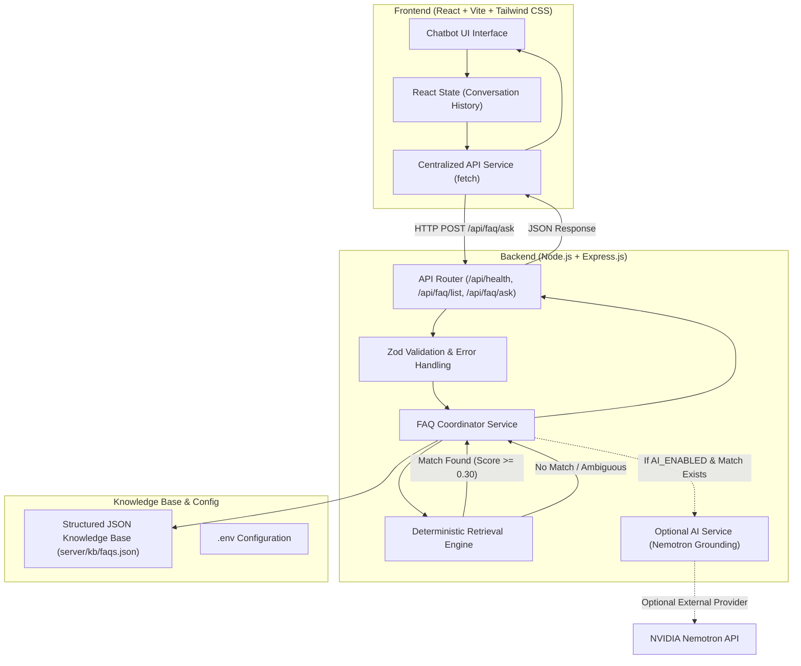
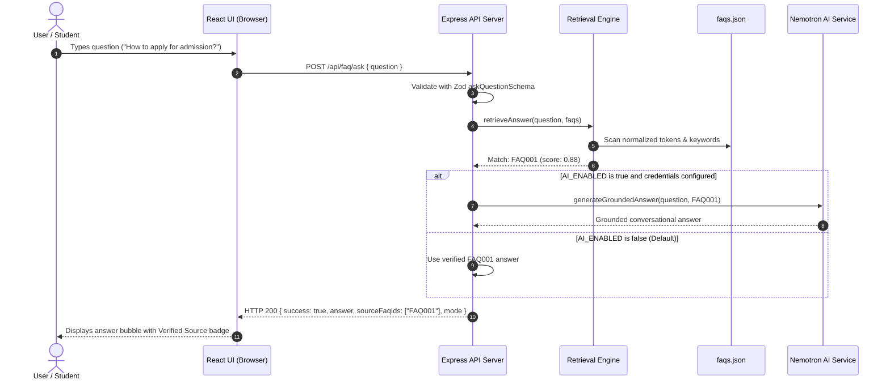

# System Architecture: AI-Powered FAQ Generator and Chatbot

## 1. High-Level Architectural Overview

The AI-Powered FAQ Chatbot is engineered as a decoupled, multi-tier web application designed specifically for college departments. The architecture prioritizes data safety, deterministic knowledge retrieval, and modular AI enhancement while remaining completely functional offline without external API credentials.

---

## 2. Core Architectural Subsystems

### 2.1 Knowledge Base & Schema Validation Subsystem
- **Source of Truth:** Single source of truth maintained in [`server/kb/faqs.json`](file:///d:/GenAI/Q1/server/kb/faqs.json).
- **Zod Schema:** Strictly validates every FAQ item, ensuring non-empty questions and answers, regex-validated IDs (`FAQ001`), controlled categories, and keyword arrays.
- **Dataset Guard:** Rejects datasets with fewer than 25 FAQs or duplicate entries.

### 2.2 Deterministic Retrieval Engine
The retrieval engine operates independently of external AI models:
1. **Normalization:** Strips non-alphanumeric punctuation and lowercases input.
2. **Tokenization & Stop Words:** Removes 90+ conversational stop words.
3. **Plural & Suffix Normalization:** Applies stemming (`libraries` -> `library`, `admissions` -> `admission`).
4. **Synonym Mapping:** Canonicalizes domain terms (`procedure` -> `process`, `charges` -> `fee`).
5. **Exact Match Check:** Detects identical questions and awards immediate 1.0 confidence score.
6. **Token Overlap Scoring:** Evaluates Jaccard-like query coverage against questions.
7. **Multi-Word & Keyword Scoring:** Awards weighted score for exact matches in pre-indexed FAQ keywords.
8. **Relevance Thresholding:** Rejects candidates scoring below `0.30` with a verified fallback message.
9. **Ambiguity Detection:** Identifies queries scoring closely between multiple candidates (delta <= 0.06) and prompts user clarification.
10. **Prompt Injection Guard:** Flags instruction override patterns (`ignore previous instructions`) and defaults to safe fallback.

### 2.3 Modular AI Service (Nemotron Grounding)
- **Zero-Dependency Fallback:** Starts cleanly when `AI_ENABLED=false` or credentials are missing.
- **Strict Grounding:** External AI is **never** invoked if retrieval cannot find a reliable match.
- **Context Injection:** Sends solely the single matched FAQ context to the LLM, prompting it never to hallucinate unverified details.
- **Failure Resilience:** In the event of provider timeout, HTTP error, or empty response, the system seamlessly returns the verified FAQ answer.

### 2.4 Modern Frontend (React + Vite + Tailwind CSS)
- **Zero-Build Overhead:** Fast hot module reloading via Vite.
- **Centralized API Client:** Encapsulates network timeouts, JSON parsing, and retry mechanics.
- **Safe Text Rendering:** Never uses `dangerouslySetInnerHTML`, ensuring immunity to XSS.
- **Responsive Layout:** Tailored for both desktop monitors and mobile devices without horizontal overflow.

---

## 3. Request-Response Sequence

